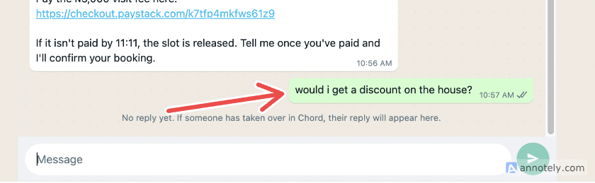
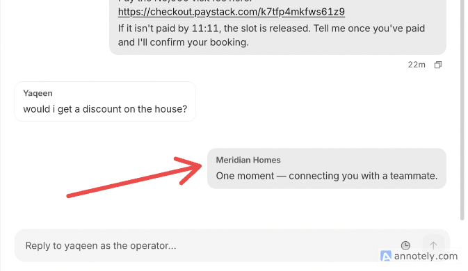

# Deployment field notes

Built and deployed on 23 October 2026. Times are WAT. Request IDs are from a local log of every Chord API call I made. Tool-call evidence is from the Worker's activity log and `wrangler tail`.

---

## 1. The agent invented a link

**What happened.** Mid-conversation, a buyer typed "can i see images". The agent replied:

> Sorry, I can only send text here, but the listing page has photos:
> https://meridian-visit-desk.vercel.app/listing/MH-005

All three parts were made up: the domain (mine is on `workers.dev`), the path (`/listing/`), and the listing (MH-005 is a different house; the buyer's visit was MH-038).

**How I found the cause.**
- The Worker logs every tool call. There were none in that turn (the last was `get_visit_status` at 11:05:54).
- `wrangler tail` showed Chord's usual start-of-turn `POST /mcp` at 11:11:37 and nothing after it, so the model answered without tools.
- The timing explained why. Skill v2, which says "share the `listing_page` link", was published at 11:09:34. The `listing_page` field shipped at 11:09:59. But the conversation's only `get_listing` result was from 11:04, before the field existed. Told to share a link it didn't have, the model wrote a plausible one.

**Fix.** Skill v3 adds two rules: "never type or guess a URL; only send links copied character for character from a tool result", and "if you don't have `listing_page`, call `get_listing` first". The same prompt now fetches the real link.

**What I'd change in Chord.** The same failure on a `payment_url` would send a buyer to a fake payment page.
- Add an optional reply guard that flags or blocks any URL that didn't appear in a tool result or the skill.
- Show a "no tools called" marker in the conversation view, so builders can spot answers made without tools.

## 2. After a handover, the buyer sees nothing in the simulator

**What happened.**
- Saturday 10:57: as a buyer, I asked "would i get a discount on the house?". The agent correctly handed over to a human, since price negotiation is out of scope.
- The simulator showed only its placeholder: "No reply yet. If someone has taken over in Chord, their reply will appear here."
- In Chord's operator view, the same conversation shows a handover message, "One moment — connecting you with a teammate.", which never reached the simulator.
- On Friday at 17:58 the same thing happened with a price dispute. I replied as the operator in Chord ("sorry about that, but our pricing has been updated") and handed back at 17:59. **The reply never appeared in the simulator either.**

**How I found the cause.** I read both threads through the API (`GET /v1/threads/{id}/turns` and `/control-events`):
- **Handover:** the agent called `handover_to_human` with a sensible reason ("Buyer asked whether they would get a discount on 41 Herbert Macaulay Way… price negotiation"), and the thread moved from `agent_active` to `human_active`.
- **Messages:** after the buyer's message there is a `system` turn (the "connecting you" text), and on Friday a `human_operator` turn (my reply). **Both have `delivery_status: "sent"`**, yet neither reached the buyer.
- **The agent's own reply is dropped.** My skill tells the agent to write "I'm passing this to our coordinator, who will reply in this chat" before handing over. There is no agent turn at all; Chord replaces it with its fixed text.
- **Likely cause:** the simulator talks to Chord through the partner API, which is send-and-reply only. A turn that ends in a handover returns no reply, and anything written later (the acknowledgement, the operator's reply) can only be read by polling the conversation's message history. The simulator doesn't seem to do that, or doesn't show `system` and `human_operator` messages.

**Fix.** I can't fix this from my side. The handover itself works, and I tested it in Chord's operator view. For the demo I show the Chord side. On a real WhatsApp channel, delivery of operator replies needs testing before go-live.

**What I'd change in Chord.**
- Make the simulator poll the conversation's messages (or push to it) so `system` and `human_operator` messages appear, as its own placeholder promises.
- Only mark a turn `sent` when a channel actually delivered it. On partner channels, "stored" and "sent" are currently the same.
- Let the skill set the handover message, or keep the agent's last reply. "Connecting you with a teammate" doesn't say what happens next, which the agency's own handover rule requires.

## 3. Skill ZIP upload broke the skill's own file references

**What happened.**
- I zipped the skill folder (`meridian-visit-desk/SKILL.md`, `meridian-visit-desk/references/…`) and uploaded it in **Create a teammate**.
- Review showed "Instructions: meridian-visit-desk/SKILL.md" and published without complaint.
- `SKILL.md` tells the model to read `references/agency.md`. The stored path was `meridian-visit-desk/references/agency.md`.
- Chord's own docs say "the path in the instructions must match the uploaded file", so the references could not resolve. Nothing warned me.

**How I found the cause.** `GET /v1/teammates/{id}/skills` returned `entrypoint: "meridian-visit-desk/SKILL.md"` and every file under that prefix.

**Fix.**
- Republished through the Skills API (`PUT …/draft` with `entrypoint: "SKILL.md"` and root-relative paths, then `POST …/publish`). It worked first time.
- Skill updates now ship from the repo through the same API calls (v2 and v3 went out this way).

**What I'd change in Chord.**
- Strip a single top-level folder on upload, as most ZIP-based uploaders do.
- At review, check every path the instructions mention against the package and warn on misses.

## 4. Couldn't find the workspace ID, and real IDs don't look like the docs

**What happened.**
- Every MCP-server endpoint is `/v1/workspaces/{workspace_id}/…`, but I couldn't find the workspace ID anywhere in the app. My first thought was that it might be my email.
- The docs' examples (`ws-a1b2c3d4`, `tm-a1b2c3d4`) suggested IDs I never saw. The real ones are `ws-3389fd22-bed3-484b-945a-c1d4bb186a3c` and a bare UUID teammate ID (`cc7d3039-…`).

**How I found the cause.** I opened browser DevTools and found it in the app's own request: `/api/proxy/v1/workspaces/ws-3389fd22-…/channel-bindings`. The teammate ID was in the page URL. Once I had a working key, `GET /v1/teammates/{id}` also returns `workspace_id`.

**Fix.** My setup script reads the workspace ID from the teammate, so I don't need to find it again.

**What I'd change in Chord.**
- Show workspace and teammate IDs, with copy buttons, in Settings and next to the API-key screen.
- Use real ID formats in the docs.
- Add `GET /v1/me` that returns the caller's workspaces and the key's permissions.

The last point would also have saved me 10 minutes: my first 403s (`Missing required permission: teammate:read`, request `ad2f7eb8-…`) turned out to be an unsaved `.env` file on my side. With no way to ask "what can this key do?", a wrong key and an under-scoped key look identical.

## 5. Autonomy: chosen at creation, no visible effect, and can't be changed by API

**What happened.**
- The **Review your teammate** screen asks for an autonomy level: *Suggest, I approve* / *Work with me* / *Act independently*. I picked **Work with me**. The screen doesn't say what each level means for a customer-facing agent.
- The teammate saved as `autonomy: "collaborative"`, with all six `capabilities` flags `false` (`execute_routine`, `own_end_to_end` and the rest) and `autonomous_ack: false`.
- In the simulator it still called every tool it needed without asking anyone: `hold_slot` (a real Paystack transaction), and `cancel_visit` at 11:28, which applied the refund policy (fee kept, under 24 hours) after the buyer said "yes". No approval step appeared anywhere, in the chat or in the Chord app. I couldn't observe any effect from the setting.
- The setting can't be changed after creation through the API (below).

**How I found the cause.**
- `GET /v1/teammates/{id}` showed the values above. The OpenAPI only describes the levels as "'assisted' (suggest only), 'collaborative' (execute routine tasks), 'autonomous' (end-to-end ownership)", with nothing on which tool calls count as "routine".
- `UpdateTeammateRequest` has no `autonomy` field. `PUT {"autonomy":"autonomous"}` returns **400 "Malformed or unrecognized request body"** (request `98b2c3c0-b7b5-41de-aaa8-05f18dbda822`), which doesn't say which field was wrong.

**Fix.** None needed for this build: the tools enforce the risky rules (refund amounts, confirmation only on Paystack's word), and tool calls run in customer chats. I left it on *Work with me*.

**What I'd change in Chord.**
- Say at creation what each level does on a customer channel. Does *Suggest* hold tool calls for approval? Do the capability flags gate anything?
- Allow changing autonomy after creation, in the app and in `PUT /v1/teammates/{id}`.
- Make the 400 name the unrecognised field.

---

## Smaller things

| What I hit | What I did | Suggestion for Chord |
|---|---|---|
| **No buyer identity reaches MCP tools.** `tools/call` carries no `_meta` and no sender/thread headers (only `user-agent: Java-http-client/23.0.2` plus Cloudflare headers). Yet the *model* knows the buyer: in a fresh session it opened with "Hello Yaqeen", my simulator display name. So the model gets the buyer's identity, but tools don't. | The agent asks for name and email; visits are looked up by email; `buyer_phone` is optional. | Opt-in `_meta` with sender ID, channel and thread ID, so tools can tie a payment to a WhatsApp number without asking for it. |
| **Replies are text only.** No attachment or media field in any chat or thread schema; the partner chat API is "synchronous text only". | Public listing pages with Open Graph tags; the agent shares the link. WhatsApp's preview bot (`WhatsApp/2.23.20.0`) fetched it within a minute. | Let a tool return an image the channel can send. |
| **The teammate gets every workspace connector by default** (`enabled_tool_types: [], unscoped: true`). The schema names native `bookings` and `paystack` connectors with `booking.*` webhooks, but `/docs/bookings` returns 404. | Scoped connectors to none (`PUT /tools {enabled_tool_types: [], unscoped: false}`) so only my 7 MCP tools are offered. Built custom because native bookings are undocumented. | Document the native connectors, or hide them from the schema until they are. Default new teammates to scoped. |
| **Defaults that widen access:** an empty `mcp_server_ids` means all servers; an empty `enabled_tools` means all tools. | Registered the server disabled, set `set_mcp_server_ids` first, then enabled it with an explicit 7-tool allowlist. Registration, discovery (7 tools, 911 ms) and health (`ok`, 21 ms) all worked first time. | Make empty mean empty, with an explicit `"*"` for all. |
| **No way to message the buyer first.** Partner chat is send-and-reply only; scheduled `WHATSAPP` tasks don't define `conversation_id`. | The buyer replies "paid"; `get_visit_status` reads what the webhook already recorded, or verifies with Paystack directly. | A documented "post to this conversation" call for tools and webhooks, e.g. payment confirmations. |
